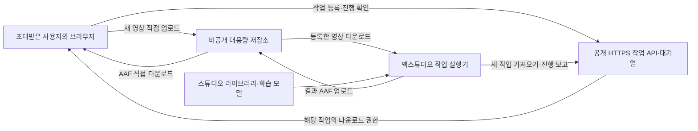

# AutoFoley · 스튜디오 라이브러리 기반 원격 작업

상태: 사용자 요구를 반영한 다음 구현 명세. 현재 SSH 연결을 이 구조로 전환한 상태는 아니다.

## 확정한 사용자 경험

- 대상: 초대한 작업자·고객. 회원가입 없이 초대 링크로 접근한다.
- 장소와 컴퓨터가 달라도 공식 홈페이지에서 작업한다. 사용자 기기에 SSH나 엔진 토큰을 설정하지 않는다.
- 사용자는 새 영상만 등록한다. 예상 영상 크기는 500MB~5GB다.
- 맥스튜디오에 있는 스튜디오의 지정 라이브러리·학습 모델로 초안을 만든다. 고객에게 기존 AAF·오디오 폴더·기존 작업 영상을 요구하지 않는다.
- 결과는 오디오를 포함한 편집 가능한 멀티트랙 AAF다. 업로드한 브라우저에서 진행 상황과 결과를 확인한다.
- 웹 디자인의 기존 큰 틀과 회사 로고는 유지한다.

## 목표 구조

맥스튜디오는 외부에 공개하는 웹 서버 대신, 외부 작업 API에 먼저 접속하는 작업 실행기로 쓴다. Mac의 사설 IP가 바뀌어도 작업 요청을 가져올 수 있다. 스튜디오 원본 라이브러리와 모델은 Mac에 남고, 중계 저장소에는 입력 영상과 해당 작업의 결과만 둔다.

현재 SSH 연결은 개발·관리용으로 유지할 수 있지만 고객용 접속 방법으로 사용하지 않는다. 공식 웹페이지와 같은 origin의 작업 API를 두고, 브라우저에서 사설 HTTP 주소를 직접 호출하지 않는다.

## 고객에게 보이는 세 단계

1. **영상 등록**: 초대 링크 확인 → 새 영상 선택 → 업로드·분석 시작. 필요 시 FPS와 시작 타임코드를 확인한다. 기존 작업 자료는 기본 화면에서 제거한다.
2. **분석 대기**: 업로드 진행 → 스튜디오 서버 대기 → 분석 단계·진행 상황. Mac이 꺼져 있거나 연결이 끊기면 대기 상태를 표시한다. 같은 작업을 중복 생성하지 않는다.
3. **AAF 다운로드**: 완료 안내 → 멀티트랙 AAF 받기 → 브라우저 다운로드 목록에서 저장 위치 확인. 새로고침해도 초대 권한과 작업 식별자로 해당 작업을 다시 확인한다.

예시 체험은 실제 처리와 구분한다. 기존 브라우저 분석은 관리·시험 경로로 유지할 수 있지만 고객의 기본 실행 경로는 원격 작업으로 바꾼다. Supabase 신청 폼은 별도로 유지한다.

## 서비스별 책임

| 구성 | 책임 |
| --- | --- |
| 기존 Vercel 웹 | 영상 등록, 업로드 진행, 작업 상태, 결과 다운로드 UI |
| HTTPS 작업 API | 초대 확인, 작업별 권한, 업로드 허가, 작업 등록·조회, 결과 접근 허가 |
| 비공개 파일 저장소 | 5GB 영상과 수 GB AAF의 직접 업로드·다운로드, 이어 올리기 |
| 작업 DB·대기열 | 작업 상태, 소유 권한, 원자적 작업 배정, 실행기 heartbeat·lease |
| 맥스튜디오 작업 실행기 | 새 요청 가져오기, 영상 저장, 기존 엔진 호출, 상태 전달, 결과 업로드 |
| 기존 Claude 엔진 | 스튜디오 데이터 검색·재조합, 영상 싱크 분석, 멀티트랙 AAF 생성 |

## 기존 엔진과의 연결

기존 `JUNOVA_ENGINE_CMD run <job_dir>` 계약을 유지한다. Mac 작업 실행기가 내려받은 영상으로 `job.json`을 만들고, 기존 `progress.json`과 `result.json`을 읽어 작업 API에 반영한다.

- `video.path`: Mac 작업 폴더에 내려받은 새 영상.
- `reference.aaf`, `reference.audio_dir`, `reference.video`: 고객 업로드를 요구하지 않으므로 기본값 null.
- 라이브러리·모델: Mac의 고정된 스튜디오 설정에서 읽는다. 브라우저가 로컬 디스크 경로나 임의 엔진 명령을 지정하게 하지 않는다.
- `output`: 기존 embedded AAF 유지. 결과 AAF와 CSV 등 허용한 파일만 비공개 저장소로 올린다.
- 작업 프로필: 초기에는 스튜디오 기본 프로필 하나. 고객에게 엔진 내부 프리셋이나 라이브러리 경로를 고르게 하지 않는다.

실제 엔진에서 참조 파일 없이 스튜디오 라이브러리를 사용하는 경로는 구현 때 다시 검증한다. 현재 문서에 보고된 실제 엔진 시험과 이 원격 작업의 종단 간 검증을 구분한다.

## 권한과 작업 안정성

- 초대 토큰은 서버에 해시만 보관하고 기간·작업 수 제한과 폐기를 지원한다. 브라우저는 확인 후 제한된 세션을 받고, 공유된 엔진 관리자 토큰을 받지 않는다.
- 고객은 자기 초대 권한에 연결된 작업만 생성·조회·취소·다운로드한다. 전체 작업 목록이나 스튜디오 파일 경로 등록 API는 고객에게 노출하지 않는다.
- 원본과 결과는 비공개 버킷에 두고 작업별 제한된 업로드·다운로드 URL을 발급한다. 객체 이름을 안다는 이유로 접근할 수 없어야 한다.
- 작업 실행기 인증은 고객 초대 인증과 분리한다. 실행기는 허가된 작업 배정·상태 보고만 할 수 있어야 한다. 전체 DB 관리자 키를 브라우저나 사용자 영상에 넣지 않는다.
- Mac에서는 기존처럼 한 번에 한 작업을 실행한다. 작업 배정은 원자적으로 처리하고, lease와 heartbeat로 중단·재시도를 관리한다. 재시도 요청이 중복 AAF나 중복 실행을 만들지 않도록 작업 ID와 실행 시도 ID를 구분한다.
- 업로드가 실제로 끝나고 파일 크기·객체가 확인된 뒤에만 작업을 대기열에 넣는다. 입력 파일은 해당 작업에 고정하고 임의 외부 URL을 내려받지 않는다.
- 결과가 저장소에 완전히 올라간 뒤에만 완료로 표시한다. 입력·결과의 보관 기간과 총 용량은 운영 전에 정한다.

## 대용량 파일 처리와 도입 조건

영상과 AAF의 본문은 Vercel Function을 통과시키지 않는다. Vercel Function의 요청·응답 본문 한도는 4.5MB다. API는 작은 JSON 요청과 파일 전송 권한만 처리하고, 실제 전송은 저장소에 직접 한다.

기존 Supabase를 우선 검토한다. Storage는 TUS 이어 올리기와 signed upload URL, 비공개 버킷의 signed download URL을 지원한다. 단, 무료 프로젝트의 파일당 한도는 최대 50MB여서 이번 목표 크기를 충족하지 못한다. 현재 계정 플랜·저장 용량·전송량을 확인하고, 대용량 설정과 비용 승인을 마친 뒤 실제 저장소를 연결한다. 이 설계 작성만으로 유료 플랜에 가입하거나 기존 플랜을 변경하지 않는다.

입력 한도는 ‘5GB’의 실제 바이트 기준을 구현 시 명시하고, 결과 AAF에도 충분한 파일당 한도를 둔다. 5GB 영상 한 개만으로 전체 필요 용량을 산정하지 않는다. 동시 대기 영상, 결과 AAF, 재시도 임시 파일과 보관 기간을 함께 계산한다.

## 구현 순서와 담당 경계

1. **연결 규격 확정**: 초대 세션·작업·실행기 API, 상태·파일 경로 규격을 정의한다.
2. **공개 플랫폼**: 기존 Supabase와 대용량 저장소 설정을 확인한 뒤, 초대 권한·작업 테이블·비공개 버킷·작업 API를 구현한다. 결제·유료 전환은 별도 승인 후 진행한다.
3. **Mac 실행기**: 전용 인증으로 작업 가져오기 → 영상 다운로드 → 기존 엔진 계약 실행 → 결과 업로드를 구현한다. 재부팅 후 시작과 네트워크 재연결도 검증한다.
4. **웹 화면**: 현재 레이아웃 안에서 영상만 입력하는 원격 작업을 기본 경로로 연결한다. 고객에게 로컬 서버 주소나 연결 토큰을 요구하지 않는다.
5. **종단 간 시험**: 초대한 사용자, 실제 다른 네트워크의 컴퓨터, 실제 엔진으로 영상 → AAF 다운로드를 확인한다. Pro Tools 가져오기는 별도 검증한다.

이 문서만 추가한 단계에서는 위 2~5가 구현·배포된 것으로 안내하지 않는다.

## 완료 기준

- 서로 다른 네트워크의 컴퓨터 두 대에서 공식 HTTPS 주소로 접속할 수 있다.
- 각 고객은 자기 영상만 올리고 스튜디오 데이터 업로드를 요구받지 않는다.
- 500MB 이상 영상과 목표 상한의 파일 전송을 확인하고, 중단 후 업로드 재개와 AAF 다운로드 재개를 검증한다.
- 다른 고객의 작업 ID·저장 경로를 알아도 상태나 파일을 읽을 수 없다.
- Mac 오프라인·재시작·네트워크 중단·작업 실패 시 상태와 복구 흐름을 확인한다.
- 스튜디오 라이브러리로 실제 초안을 만들고 해당 브라우저에서 오디오 포함 AAF를 받는다.
- 기존 신청 폼과 디자인을 유지하고 비밀 키·원본 데이터·모델을 공개 저장소에 올리지 않는다.

## 근거 자료

- [Vercel Functions 제한](https://vercel.com/docs/functions/limitations)
- [Supabase 파일 크기 제한](https://supabase.com/docs/guides/storage/uploads/file-limits)
- [Supabase 이어 올리기·signed upload](https://supabase.com/docs/guides/storage/uploads/resumable-uploads)
- [Supabase 비공개 버킷](https://supabase.com/docs/guides/storage/buckets/fundamentals)
- [Supabase Queues](https://supabase.com/docs/guides/queues)
